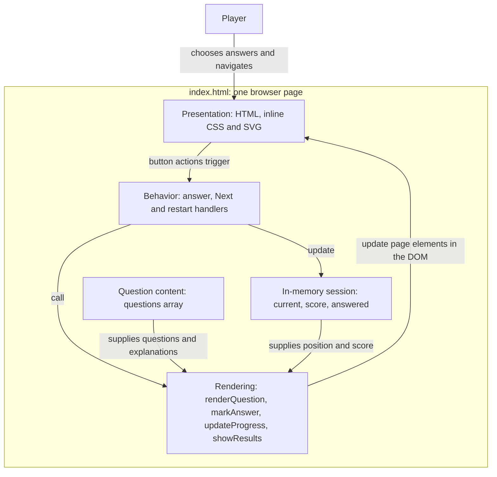

# README - Copilot Dev Days

Hello! This is where we'll demo the Copilot CLI using this workshop: https://github-samples.github.io/copilot-workshops/first-steps/copilot-cli/

## Meet Orbit Academy

Orbit Academy is a 10-question, browser-only space exploration quiz. Choose an
answer, learn from its explanation, and see your final score. There is no timer,
and you can restart when you finish.

## Run it locally

Open [index.html](index.html) directly in your browser, for example by using the
browser's **Open File** command. On macOS, you can run this from the repository:

```sh
open index.html
```

Keep JavaScript enabled. The quiz works offline over `file://`. There is no
server, database, build step, package installation, or external dependency.

## Architecture at a glance

Everything lives in [index.html](index.html): HTML provides the page structure,
inline CSS controls its appearance, inline SVG draws the illustrations, and
JavaScript runs the quiz. The diagram shows logical responsibilities within
that **one file**, not separate modules or services.



The content and session state are small JavaScript values:

- **Question content** lives in `questions`. Each entry has a `category`,
  `question`, four `answers`, a zero-based `correct` answer index, and an
  `explanation`.
- **Session state** tracks the current question's zero-based index (`current`),
  the number of correct answers (`score`), and whether the current question has
  already been answered (`answered`).

Nothing is saved to storage. Refreshing the page resets the session.

## Follow one quiz session

The functions below are all in the script at the end of
[index.html](index.html).

1. **Start with the first question.** Once the markup is available, the script
   initializes the session and calls `renderQuestion()`. It fills in the
   question, creates answer buttons, clears feedback, and disables Next until
   an answer is chosen.
2. **Choose an answer and get feedback.** An answer button calls
   `selectAnswer()`. It accepts only the first selection, sets `answered`, and
   adds one point if the answer is correct. `markAnswer()` labels the correct
   answer and any incorrect selection with visual and screen-reader indicators.
   The explanation appears and Next becomes available. Repeated selections are
   ignored, so they cannot change the score or chosen answer.
3. **Watch completed-answer progress advance.** `updateProgress()` updates the
   progress indicator and score. Progress counts answered questions, not
   questions displayed: it advances on selection, before you press Next.
4. **Move on or finish.** The Next button's handler advances `current` and calls
   `renderQuestion(true)` to display and focus the next question. After the last
   answer, the same button calls `showResults()` instead. This swaps the quiz
   panel for results and chooses a message for scores of 0–3, 4–6, 7–9, or 10.
5. **Explore again.** The restart handler resets `current` and `score`, then
   calls `renderQuestion(true)`, which also resets `answered` and returns focus
   to the first question.

The connection between the page and script is the DOM, the browser's
representation of the HTML. Element IDs such as `answers`, `feedback`, and
`next` let the `byId()` helper find the elements that the functions update.

## Accessibility and appearance

The quiz supports keyboard operation with native buttons, a skip link, focus
movement between questions and results, and live feedback for screen readers.
Answer buttons remain focusable after selection using `aria-disabled`; the
`answered` guard prevents further choices. Next uses native `disabled` until
an answer is selected. Correctness is conveyed through text and icons as well
as color.

Styles adapt to narrow screens and system light or dark themes, respect
reduced-motion preferences, and include forced-colors support.

For detailed contributor conventions and manual browser checks, see
[.github/copilot-instructions.md](.github/copilot-instructions.md).
